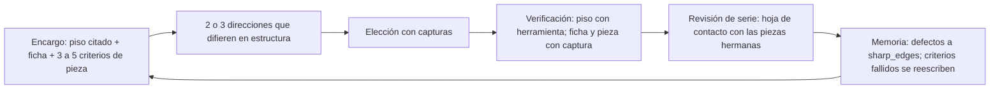

# Marco para criterios de UX/UI que no se repitan

**Fecha:** 17-nov-2026 · **Estado:** propuesta, nada aplicado · **Origen:** análisis del doc [Skills de diseño UX/UI para agentes: Claude, Codex, Gemini y DeepSeek](https://claude.ai/artifact/WJfFaYH3vmDWbQkHkcV1mv), de `~/.agents/rules/navegador-agentes.md`, de la skill `tastemaker` instalada y de las fichas de `laboratorio-video/estilos/`.

## Resumen

Un criterio se repite cuando puede copiarse a otro proyecto sin cambiarle una palabra. El marco hace tres cosas: separa los criterios en tres niveles según cuánto **deben** repetirse, fija una forma para escribir cada uno y pasa cada criterio por cuatro filtros que descartan los intercambiables. No inventa un molde nuevo: extiende a interfaces la ficha que ya usas en el laboratorio de video (`patterns`, `sharp_edges`, `validations`, `nivel`).

Leí «no repetitivos» en tres sentidos y el marco atiende los tres. La pregunta 1 fija cuál pesa más.

1. Entre proyectos: lo que producen los agentes se parece.
2. Dentro de un proyecto: todas las pantallas salen de la misma plantilla.
3. En los criterios mismos: las listas repiten lo que ya dicen las skills y las reglas.

## Qué aporta el documento

| Hallazgo del documento | Consecuencia para los criterios |
|---|---|
| La verificación visual es la capa que más pesa: una skill no ve lo que acaba de producir | Todo criterio se comprueba sobre una captura, no sobre el código ni sobre la intención |
| SkillsBench: las skills enfocadas, de hasta tres módulos, superan a los paquetes exhaustivos | Presupuesto: pocos criterios por encargo |
| `taste-skill` depende de que el modelo obedezca prosa | Criterios de sí o no, sin adjetivos |
| UI/UX Pro Max consulta un catálogo por palabras clave y devuelve resultados irrelevantes | Los criterios salen del proyecto, no de un catálogo |
| `DESIGN.md` une los tokens con su justificación | Cada criterio lleva su porqué en este proyecto |
| «Pide dos o tres direcciones antes de pulir» | Divergir antes de converger, y exigir que las direcciones difieran de verdad |
| La evidencia de eficacia es anecdótica o interesada | El marco registra sus propios fallos para tener evidencia propia |

## Qué le falta para este propósito

- **Responde qué instalar, no qué pedir.** Una skill son los criterios de otra persona, iguales para todos los que la instalan. Impeccable lleva las mismas siete referencias a cada proyecto: mejora el acabado, no evita el parecido.
- **Las listas anti-slop son listas negras.** Prohibir el degradado índigo lleva al modelo a su segundo default, no a una identidad. Una prohibición general no distingue un proyecto de otro.
- **La UX queda como lista de reglas.** La capa de auditoría revisa accesibilidad y rendimiento, pero ningún criterio parte de lo que una persona concreta viene a hacer en esa pantalla.
- **En lo ya instalado:** `tastemaker`, cuando no hay referencias, elige paleta y fuente con una tabla de *moods* por palabras clave (el mismo mecanismo que el documento critica en UI/UX Pro Max). Además impone tres defaults «no negociables» a todo proyecto: movimiento GSAP siempre, visual sobre texto siempre y ninguna sección sin recurso. Aplicados a todo, uniforman. Y guarda su propio `.tastemaker/style-lock.md`, una segunda fuente de identidad junto a la ficha.

## El marco

### 1. Tres niveles, según cuánto debe repetirse cada criterio

| Nivel | Qué fija | ¿Debe repetirse? | Dónde vive | Cómo se comprueba |
|---|---|---|---|---|
| **Piso** | Contraste, teclado, foco, 390 px, zoom 200 %, modo oscuro, carga | Sí, idéntico en todo proyecto | Una sola vez, en la regla global; los encargos lo citan, no lo copian | Con herramienta: `chrome-devtools lighthouse_audit`, comprobador de contraste |
| **Identidad** | Lo que hace reconocible al proyecto: tokens con su justificación, rasgo propio, prohibiciones propias | Dentro del proyecto sí; entre proyectos no | Ficha del proyecto | Captura, por un revisor que no vio el código |
| **Pieza** | La decisión de esta pantalla: qué viene a hacer la persona y con qué composición se resuelve | No: cada pieza tiene la suya | El encargo | Captura, más comparación con las piezas hermanas |

La repetición aparece cuando los niveles se mezclan. Si el piso se copia en cada ficha, hay ruido. Si la identidad se escribe como regla universal, todos los proyectos se parecen. Si falta el nivel de pieza, todas las pantallas salen de una plantilla.

### 2. Forma de un criterio

Cada criterio de identidad o de pieza tiene cuatro campos:

1. **Eje:** la decisión que gobierna (uno solo; ver el mapa de ejes).
2. **Origen:** de qué sale en este proyecto (el contenido, la audiencia, una referencia, una restricción).
3. **Regla y lo que desplaza:** qué se hace y qué default deja fuera.
4. **Comprobación:** una pregunta de sí o no que se contesta mirando una captura.

Un criterio sin origen propio es piso o es relleno.

**Ejemplo que no pasa:** «Jerarquía visual clara y buen contraste». Se trasplanta a cualquier proyecto y nadie defendería lo contrario.

**Ejemplo de identidad** (ilustrativo, sobre la ficha Pulso; no es una regla propuesta):

- Eje: color.
- Origen: Pulso tiene dos tintas, verde y mandarina; el curso se recorre en el teléfono y la persona necesita ver qué sigue.
- Regla: la mandarina `#e2672c` marca solo el paso siguiente. Desplaza el acento repartido en iconos, bordes y títulos.
- Comprobación: en la captura a 390 px, ¿hay un único elemento con relleno mandarina y es la acción siguiente?

**Ejemplo de pieza** (inventado, para mostrar el nivel):

- Eje: orden de entrada.
- Origen: quien abre la unidad llega desde un aviso de su asesor que menciona una fecha de entrega.
- Regla: lo primero visible es qué se entrega y cuándo; el contexto va después. Desplaza el encabezado de bienvenida con imagen que ocupa la primera pantalla.
- Comprobación: en la captura a 390 px, sin desplazar, ¿se leen la entrega y la fecha?

### 3. Cuatro filtros

Un criterio entra en una ficha o en un encargo solo si pasa los cuatro.

| Filtro | Pregunta | Si falla |
|---|---|---|
| **Trasplante** | ¿Se podría copiar tal cual a otro proyecto? | Baja a piso o se elimina |
| **Negación** | ¿Alguien razonable habría hecho lo contrario? | No decide nada; se elimina o se concreta |
| **Captura** | ¿Se contesta sí o no mirando un render, sin leer el código? | Se reescribe hasta que se pueda |
| **Duplicado** | ¿Ya lo cubre el piso, una skill o la ficha? | Se cita, no se repite |

### 4. Mapa de ejes: qué se fija y qué queda abierto

Cada ficha declara, eje por eje, si está **fijo** (identidad) o **abierto** (lo decide cada pieza).

| Grupo | Ejes |
|---|---|
| Estructura | composición y retícula · densidad · orden de entrada · navegación |
| Superficie | tipografía · color · forma (radios, bordes, sombras) · material o textura · tipo de imagen (foto, ilustración, diagrama, dato) · movimiento |
| Conducta | estados (vacío, error, carga) · retroalimentación · voz del texto de interfaz |

Dos reglas de variación:

- **Dentro de un proyecto,** al menos dos ejes de estructura quedan abiertos. Así hay variedad con identidad: la superficie reconoce al proyecto y la estructura responde a cada contenido.
- **Entre direcciones alternativas,** una dirección cuenta como distinta solo si cambia al menos dos ejes de estructura. Tres paletas sobre la misma retícula son una sola dirección.

### 5. Ciclo de trabajo



- **Encargo.** Lleva el piso por referencia, la ficha del proyecto y de tres a cinco criterios de pieza. Nada más: es el presupuesto que sugiere SkillsBench y la regla que ya aplicas en video («al encargo solo entra la ficha de su estilo»).
- **Verificación.** Capturas a 390 px y escritorio, en claro y oscuro. El piso lo mide la herramienta; la ficha y la pieza las contesta un revisor que no vio el código.
- **Revisión de serie.** Las capturas de las piezas hermanas se ponen juntas. Pregunta: ¿dos piezas con contenido distinto comparten la misma composición? Es la revisión de serie del canon de presentaciones, llevada a pantallas.
- **Memoria.** Cada defecto encontrado añade una línea a `sharp_edges.md`. Los criterios nacen de fallos reales, y por eso no se parecen a los de otro proyecto. Para añadir un criterio a la ficha se funde o se retira otro: la ficha no pasa de una página.

### 6. Ficha de UI

El mismo molde del laboratorio de video, con dos cambios: `patterns.md` incluye el mapa de ejes y hay un `nivel` por tamaño.

```
<proyecto>/diseno/
  patterns.md        tokens con su justificación y mapa de ejes (fijo o abierto); una página
  sharp_edges.md     lo que ya falló, con la pieza y la captura; no se borra
  validations.md     preguntas de sí o no sobre capturas; ninguna de gusto
  nivel-390.jpg      el listón en teléfono
  nivel-escritorio.jpg
```

`patterns.md` cumple el papel de `DESIGN.md`. Si conviene la compatibilidad con la especificación de Google Labs se le puede dar ese nombre; sigue en borrador, así que no lo propongo por ahora.

### 7. Lo que el marco no resuelve

- **No mide «vistoso».** Lo sustituye por comprobaciones de identidad y de tarea. El gusto sigue siendo tuyo al elegir entre direcciones.
- **No está probado.** Sale del documento y de la práctica del laboratorio de video. La primera prueba dirá qué filtros sirven.
- **Cuesta capturas.** Cada pieza se renderiza y se revisa. Con el CLI `chrome-devtools` se evita cargar los esquemas del MCP (unos 17 mil tokens, según el documento).

## Preguntas

:::question
¿Qué repetición atacamos primero?

El marco cubre las tres; la respuesta decide qué se prueba y se mide en la primera tanda.

- [ ] Entre proyectos — lo que producen los agentes se parece de un proyecto a otro
- [ ] Dentro de un proyecto — todas las pantallas salen de la misma plantilla
- [ ] En los criterios mismos — las listas repiten lo que ya dicen skills y reglas
- [ ] Las tres por igual — sin prioridad en la primera tanda
:::

:::question
¿En qué proyecto probamos el marco primero?

La prueba consiste en escribir la ficha de UI, encargar dos o tres piezas y pasar el ciclo completo.

- [ ] Cursos Moodle con identidad Pulso (FD-LIA y FI) — ya hay ficha de identidad; solo se añade la parte de UI
- [ ] Sitio Hugo aprendizaje-ia — tiene estilo propio y los PR pasan por CI
- [ ] Consola de microcredenciales (Nuxt) — interfaz de aplicación, sin ficha
- [ ] Cartografías antifascistas (Hugo) — sitio nuevo, identidad sin cerrar

Recommended: Cursos Moodle con identidad Pulso (FD-LIA y FI) — ya hay ficha de identidad; solo se añade la parte de UI
:::

:::question
¿Dónde vive el marco?

- [ ] Regla corta más plantilla de ficha — `~/.agents/rules/criterios-ux-ui.md` y una línea en `AGENTS.md`; la leen todos los agentes, sin skill nueva
- [ ] Skill propia `criterios-ux-ui` — los filtros y el ciclo como pasos, en `~/.agents/skills`; un módulo más que cargar
- [ ] Solo dentro de cada proyecto — cada ficha trae sus reglas y no hay nada global

Recommended: Regla corta más plantilla de ficha — `~/.agents/rules/criterios-ux-ui.md` y una línea en `AGENTS.md`; la leen todos los agentes, sin skill nueva
:::

:::question
¿Qué hacemos con `tastemaker`?

- [ ] Subordinarlo a la ficha — la regla indica que la ficha es la fuente, que `style-lock.md` se deriva de ella y que no aplican la tabla de moods ni el movimiento obligatorio; la skill no se edita
- [ ] Usar `frontend-design` cuando haya ficha — `tastemaker` queda solo para arranques sin identidad
- [ ] Probar Impeccable en su lugar — fijando tag o SHA y leyendo los scripts antes de instalar
- [ ] No tocar nada todavía — se decide después de la primera prueba

Recommended: Subordinarlo a la ficha — la regla indica que la ficha es la fuente, que `style-lock.md` se deriva de ella y que no aplican la tabla de moods ni el movimiento obligatorio; la skill no se edita
:::

:::question-text
¿Qué interfaz reciente te pareció repetida y cuál no?

Una o dos de cada una (ruta, URL o nombre del proyecto). Sirven de `nivel` y de contraejemplo para calibrar los filtros con casos tuyos.
:::

## Respuestas (2026-11-17)

Recibidas por Plannotator, copiadas literalmente:

```
# File Feedback

## Answers to your questions

4 of 5 questions answered.

### Q1. ¿Qué repetición atacamos primero? (line 140)
Answer: Entre proyectos

### Q2. ¿En qué proyecto probamos el marco primero? (line 151)
Answer: Cursos Moodle con identidad Pulso (FD-LIA y FI) (your recommendation)

### Q3. ¿Dónde vive el marco? (line 164)
Answer: Regla corta más plantilla de ficha (your recommendation)

### Q4. ¿Qué hacemos con `tastemaker`? (line 174)
Answer: Subordinarlo a la ficha (your recommendation)

### Unanswered
- Q5. ¿Qué interfaz reciente te pareció repetida y cuál no? (line 185)
```

Aplicado el 17-nov-2026:

- Q3 y Q4: regla `casa.lnk/.agents/rules/criterios-ux-ui.md` (enlazada en `~/.agents/rules/` y registrada en `.lnk.casa`) con la plantilla de ficha y la subordinación de `tastemaker`; una línea en `casa.lnk/AGENTS.md`. La skill `tastemaker` no se editó. Sin commit.
- Q1: la regla pide comparar las capturas de una ficha con las de otro proyecto antes de cerrarla.
- Q2: prueba pendiente de arrancar en el repo de los cursos Pulso.
- Q5: sin respuesta; los `nivel` de la ficha quedan por elegir.

## Ajustes posteriores (2026-11-18)

Tras la prueba en Pulso, con VoBo de Rubén en el repo de cursos (`~/Projects/udgplus/forja/cursos-formación-docente-con-ia/.revision/`):

- `resultados-prueba-ui-pulso-2026-11-18.md`: la comprobación mide el resultado y no el medio.
- `integracion-h5p-pulso-2026-11-18.md`: sección «Piezas fijas» en la regla y en el esqueleto de `patterns.md`; commit y push de la regla en este repo.
